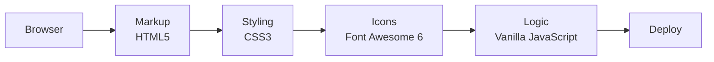

<h1 align="center">Wade — Tech Store Landing Page</h1>

<p align="center"><b>The first front-end project I ever built: a tech store landing page with a video section, product gallery and testimonials.</b></p>

<p align="center">
[](https://mister2314.github.io/First-Project/)


</p>

<p align="center">[**Live demo**](https://mister2314.github.io/First-Project/) · [Quick start](#quick-start) · [Features](#features) · [Architecture](#architecture) · [FAQ](#faq)</p>

<p align="center">
  <a href="https://mister2314.github.io/First-Project/">
    
  </a>
</p>

<p align="center"><sub>Live capture of the real build — 2620 KB, loops forever.</sub></p>

## Overview

The first project I ever put on GitHub, built while learning HTML and CSS from scratch. It is a landing page for a fictional tech store, and it covers the classic section set: a parallax-style hero, a video block, a product gallery, testimonials and a footer.

I keep it public because it is the honest starting point. The newer repositories in this profile show where the work went from here.

## At a glance

| Field | Detail |
| --- | --- |
| **Type** | Static site — no build step |
| **Primary language** | CSS |
| **Live demo** | [mister2314.github.io/First-Project](https://mister2314.github.io/First-Project/) |
| **Repository** | [Mister2314/First-Project](https://github.com/Mister2314/First-Project) |

## Features

- Hero section with parallax-style background imagery
- Embedded video section
- Product gallery grid
- Customer testimonial cards
- Icon and material-symbol sets
- Multi-resolution favicon assets
- Responsive single-column reflow on mobile

## Tech Stack

| Layer | Technology |
| --- | --- |
| Markup | HTML5 |
| Styling | CSS3 |
| Icons | Font Awesome 6, Material Symbols |
| Logic | Vanilla JavaScript |
| Deploy | GitHub Pages |

## Architecture



## Screenshots

| Desktop | Mobile |
| :---: | :---: |
|  |  |

## Quick Start

```bash
git clone https://github.com/Mister2314/First-Project.git
cd First-Project

# open it directly
start index.html      # Windows
open  index.html      # macOS

# or serve the folder
npx serve .
```

## Project Structure

```
index.html — the full landing page
assets/css/style.css — all layout and component styles
assets/img/ — product, gallery and testimonial imagery
assets/video/ — section video asset
```

## Notes

My first repository. Left public as a baseline — everything else in this profile is measured against it.

## Author

**Xəyal Hüseynli** — Junior Front-End Developer

[Portfolio](https://hypnosdev.vercel.app) · [GitHub](https://github.com/Mister2314) · [LinkedIn](https://www.linkedin.com/in/x%C9%99yal-h%C3%BCseynli-3487b91ba/) · [xeyalhuseynli06@gmail.com](mailto:xeyalhuseynli06@gmail.com)
