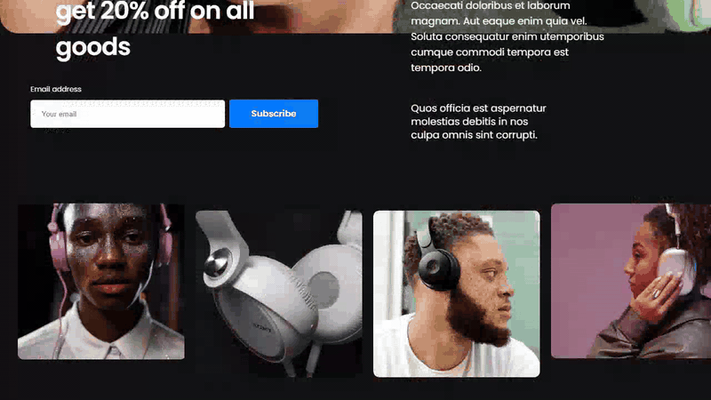
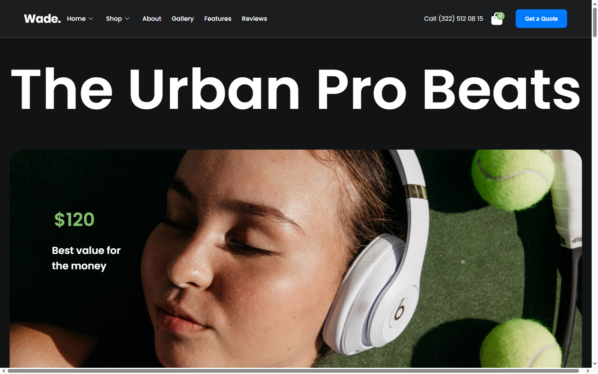
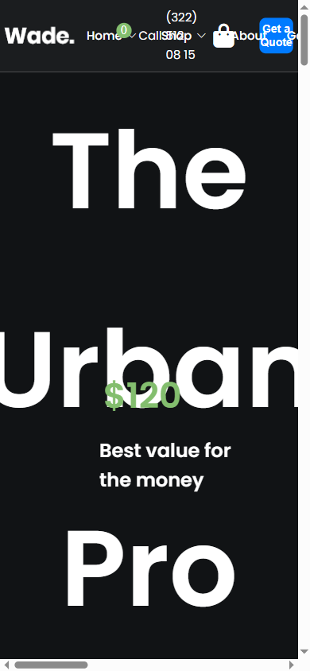
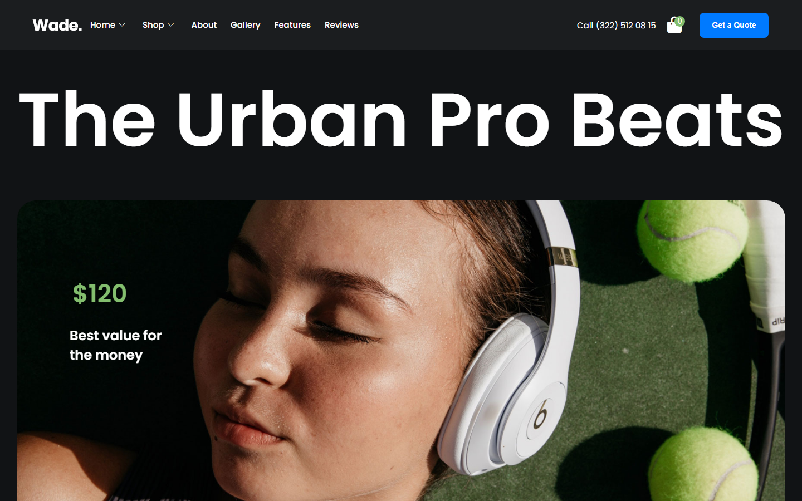
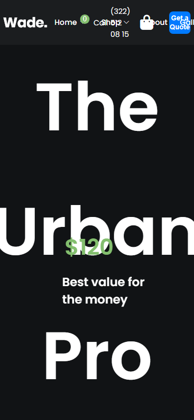

# Wade — Tech Store Landing Page

A landing page for a fictional tech store — the first front-end project I ever built, kept public as a baseline. In 2026 it went through a motion-and-accessibility revamp that kept the original identity: dark showroom chrome, Apple-blue accent, Poppins.

**Live demo:** https://first-project-mister2314.vercel.app/

<div align="center">



| Desktop | Mobile |
|---|---|
|  |  |

<details>
<summary>More screenshots</summary>

| Desktop | Mobile |
|---|---|
|  |  |

</details>

</div>

## What it does

A single static page with the full landing-page section set: product hero, subscribe blocks, product grid, embedded video, stats, gallery, features, testimonials and footer. All 14 sections are kept; the 2026 revamp re-choreographed how they arrive.

## Tech stack

React 19 · TypeScript 5.8 · Vite 6 · GSAP 3 (ScrollTrigger) · Lenis · ESLint 9

## Features

- Dark/light theme — system preference by default, persisted manual toggle, set before first paint (no flash); the light palette is designed, not inverted
- Scroll choreography — staggered section reveals driven by GSAP ScrollTrigger over the original `data-aos` hooks, one parallax accent, no pinned sections
- Smooth scrolling via Lenis with native momentum on touch devices
- Sticky compact nav — the header shrinks with a backdrop blur after 40px of scroll
- Product-card micro-interactions — hover image scale, focus states, add-to-cart with an animated cart-count badge
- Editorial index treatment — hairline rules, oversized price numerals
- Accessibility — real nav anchors, labeled inputs, skip link, `:focus-visible` rings, alt text
- `prefers-reduced-motion` — every animated element has a static equivalent; nothing depends on motion to be readable
- Mobile is its own composition (single-column products, restacked hero), not a squeezed desktop
- Font Awesome 6 and Material Symbols icon sets, multi-resolution favicons

## Run locally

```bash
git clone https://github.com/Mister2314/First-Project.git
cd First-Project
npm install
npm run dev      # dev server
npm run build    # type-check + production build
npm run lint     # eslint over src/
npm run preview  # serve the production build
```

## Project notes

The revamp lives on the `revamp/firstproject` branch history; the pre-revamp state is tagged `pre-revamp-firstproject`. The motion system is one hook (`src/useAos.ts`) that maps the old AOS attributes onto GSAP timelines, so the section markup stayed untouched.
